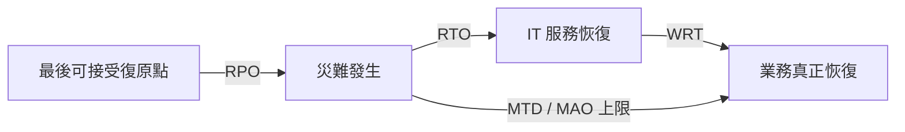

# CCSP 兩日錯題修復講義＋閃卡
**範圍：近兩日 D1 / D3 / D4 / D5 / D6 交叉錯題與 LearnZapp 題庫陷阱**  
**用途：Closed-book maintenance recall / targeted remediation**

---

# 0. 兩日總結：先修真正缺口，不被爛題拖走

這兩天的錯題大致可拆成兩類：

1. **真正需要修的知識／判斷缺口**
   - BC/DR 時間軸：RPO / RTO / WRT / MTD
   - BIA 的功能邊界
   - D3 實體韌性與站點分離
   - 基準映像（baseline image）vs 弱點掃描（vulnerability scan）
   - 遺失裝置：追蹤（tracking）vs 憑證撤銷（credential revocation）
   - 代理聯邦（proxy federation）vs 交叉認證（cross-certification）
   - Brewer–Nash / Chinese Wall
   - SAST / DAST / IAST
   - Open Redirect 的真正工程修補
   - SOC 2 vs SOC 3
   - 對稱式加密的精確術語：共享秘密金鑰
   - 風險處置後的殘餘風險（residual risk）

2. **題目品質差、應 `[Q]` 降權**
   - 「PaaS 因常用於軟體開發，所以更容易有後門」
   - PCI 商家等級精確門檻
   - SOC 3「雲端客戶最可能收到」
   - 「遊戲開發者一定要排除測試」
   - 「過度安全控制只會造成不必要支出」
   - 「object storage = 真正 filesystem hierarchy」
   - 「CDN 是 SaaS 最典型 storage type」
   - 「backup physical location 幾乎只剩 regulatory compliance」
   - 某些 physical resiliency / environmental 題目的過度絕對化

> **學習原則：**  
> LearnZapp 用來找漏洞，不用來改壞工程直覺。  
> 題目若把現代實務的多維問題硬壓成單一絕對答案，要保留正確模型並標 `[Q]`。

---

# 1. BC/DR：四個時間指標

## 1.1 RPO — 復原點目標（Recovery Point Objective）

**問：最多可以丟多少資料？**

- 衡量的是**可接受的資料損失時間窗**
- 看的是「故障前多久的資料必須保住」
- 例：每 15 分鐘備份一次，公司最多接受 15 分鐘交易遺失  
  → **RPO = 15 分鐘**

### 最短模型

> **RPO = Data Loss**

---

## 1.2 RTO — 復原時間目標（Recovery Time Objective）

**問：IT 服務多久內要恢復？**

- 從中斷發生開始，到技術服務恢復
- 衡量的是**服務中斷可接受多久**

例：

- 08:00 災難
- 11:00 IT 系統恢復

→ **RTO 實際耗時 = 3 小時**

### 最短模型

> **RTO = IT Back**

---

## 1.3 WRT — 工作復原時間（Work Recovery Time）

**問：IT 已恢復後，業務還要多久才能真正正常運作？**

例如：

- 11:00 IT 服務恢復
- 12:30 訂單同步、驗證、流程重啟完成

→ **WRT = 1.5 小時**

### 最短模型

> **WRT = Business Back**

---

## 1.4 MTD / MAO — 最大可容忍停機時間／最大可接受中斷時間  
(Maximum Tolerable Downtime / Maximum Acceptable Outage)

**問：整個業務最多能忍受多久不能正常營運？**

通常：

> **RTO + WRT ≤ MTD**

例：

- RTO = 4h
- WRT = 2h
- MTD = 8h

→ 4 + 2 = 6h ≤ 8h，合理。

若：

- RTO = 7h
- WRT = 2h

→ 9h > 8h，復原策略失敗。

---

## 1.5 時間軸

### 防呆

- 看到 **Point** 不代表答案一定是 RPO
- RPO 看「資料往回丟多少」
- RTO 看「系統多久回來」
- WRT 看「系統回來後，業務還要整理多久」
- MTD 是整體不可超過的上限

---

# 2. BIA：業務衝擊分析（Business Impact Analysis）

BIA 主要回答：

- 哪些業務／資產最重要？
- 中斷後的業務衝擊有多大？
- 依賴關係是什麼？
- RTO / RPO / MTD 應如何設定？
- 哪些控制投資值得做？

## 2.1 BIA 可以支援什麼？

| 項目 | 是否直接受 BIA 支援 | 原因 |
|---|---:|---|
| 風險分析 | ✅ | 提供資產價值、業務衝擊 |
| BC/DR 規劃 | ✅ | 提供 criticality 與復原優先順序 |
| 安全控制選擇 | ✅ | 控制成本應與資產價值／風險匹配 |
| 安全採購（secure acquisition） | ⚠️ 間接 | BIA 可影響需求，但不是 acquisition process 本身 |

### 判題規則

> 題目問「BIA **提供資訊**給哪個流程」  
> → risk / control selection / BC/DR 都合理。

> 題目問「BIA 本身是否就是 acquisition 活動」  
> → 不是。

---

# 3. BC/DR Backup Location：備份／DR 位置不是只看法規

實體位置會影響：

1. **法規／司法管轄（jurisdiction）**
2. **地理冗餘**
3. **共同失效域（common failure domain）**
4. **洪水／地震／颱風／高溫等環境風險**
5. **電力與上游電信**
6. **網路延遲與跨區複寫**
7. **支援人力與供應鏈**
8. **成本**

### 最短模型

> **DR Location = 法律 + 災害 + 故障域 + 可達性 + 成本**

### `[Q]` 題庫陷阱

若題目說：

> physical location matters because it may affect regulatory compliance

這是**合理答案之一**，但不能推導成：

> environmental / physical / redundancy 不重要。

---

# 4. 實體韌性（Physical Resiliency）

## 4.1 線路從建物不同側進入

目的：

> 避免一次施工、挖斷、撞擊、局部火災等事件同時切掉主線與備線。

### 最短模型

> **不同路徑 ≠ 同一故障點**

但這不代表：

- 洪水
- 區域性停電
- 大地震
- 上游 carrier failure

一定能被解決。

所以它是**降低特定共同失效風險**，不是萬能。

---

## 4.2 耐震地基

「耐震」當然屬於實體韌性。

如果題庫說它不是「全球 universal best practice」，原因通常是：

> 某些控制高度依地區威脅模型。

### 判題原則

- 題目問「physical resiliency 控制」→ 耐震合理
- 題目問「所有資料中心都必須如此」→ 要看是否過度絕對

---

# 5. 基準映像（Baseline Image）vs 弱點掃描

## 5.1 基準（Baseline）

> 一個**已核准、可重複部署的安全狀態**

通常包含：

- OS hardened settings
- 必要 agent
- logging
- endpoint protection
- patch baseline
- account policy
- approved packages

## 5.2 弱點掃描（Vulnerability Scan）

> 驗證目前狀態是否存在弱點。

它不是 baseline 本身。

## 5.3 修復（Remediation）

> 把 scan 找到的問題修掉，再重新核准 baseline。

### 最短模型

> **Baseline = 核准狀態**  
> **Scan = 驗證**  
> **Remediation = 修正**

### Golden Image

寫入保護（write protection）／不可變（immutable）更適合保護：

> **master image artifact**

而不是讓每個正常執行中的 VM 無法寫入。

---

# 6. 遺失裝置：Tracking vs Credential Revocation

題目：

> A process for ______ can aid in protecting against data disclosure due to lost devices.

## 6.1 裝置追蹤（Device Tracking）

作用：

- 找回設備
- 定位
- 協助 incident response

但：

> 找得到 ≠ 阻止攻擊者使用裝置上的 session/token/credential。

## 6.2 憑證撤銷（Credential Revocation）

作用：

- revoke session
- disable token
- revoke cert
- disable user/device credential
- cut off access

### 最短模型

> **Tracking = 找設備**  
> **Revocation = 切斷存取**

若題目動詞是：

> protect against data disclosure

優先考慮直接控制：**撤銷憑證**。

---

# 7. 身分聯邦：代理聯邦 vs 交叉認證

## 7.1 代理聯邦（Proxy Federation）

題庫舊模型：

> 一個第三方代表所有成員，審查／驗證各成員是否符合共同信任要求。

### 最短模型

> **Proxy = 中央第三方代審**

## 7.2 交叉認證（Cross-Certification）

> 兩個或多個信任域互相承認彼此的憑證／信任關係。

### 最短模型

> **Cross-Cert = 成員彼此信**

### 注意

這裡的 proxy 不是「代理伺服器」。

是：

> **信任代理人／中介者**

---

# 8. Brewer–Nash Model = Chinese Wall Model

中文可稱：

> **Brewer–Nash 利益衝突隔離模型／中國牆模型（Chinese Wall Model）**

核心：

> 防止同一使用者依序存取彼此具有商業利益衝突的資料集合。

例：

- 顧問先存取銀行 A 客戶資料
- 後續不得再存取直接競爭的銀行 B 客戶資料

它是一種：

> **動態存取控制（dynamic access control）**

存取決策依：

- 使用者先前看過什麼
- 是否形成利益衝突

而改變。

### 最短模型

> **Chinese Wall = 防利益衝突，不是防火牆產品**

### 考試重要度

**P2 / 認得即可。**

---

# 9. SAST / DAST / IAST 最短模型

| 類型 | 看得到內部？ | App 要執行？ | 常見分類 |
|---|---:|---:|---|
| 靜態應用程式安全測試（SAST） | ✅ | ❌ | 白箱 |
| 動態應用程式安全測試（DAST） | ❌ 通常 | ✅ | 黑箱 |
| 互動式應用程式安全測試（IAST） | ✅，有 instrumentation | ✅ | 混合／內部觀測 |

## 9.1 白箱／黑箱不是看「測試者是不是公司員工」

真正是：

> **測試方法是否取得內部實作資訊。**

所以：

- 私有 Git repo 不影響 SAST 是白箱
- 外部人士若拿不到 source code，根本無法執行真正 SAST
- 這是 access prerequisite，不是分類規則

---

# 10. Open Redirect / Unvalidated Redirect

## 10.1 真正工程修補

不要把任意外部 URL 直接當 redirect target。

常見安全設計：

- allowlist
- server-side mapping：`id -> approved URL`
- 嚴格驗證 redirect destination
- 避免直接相信 user-supplied URL

### 最短模型

> **Open Redirect = 驗證 destination**

## 10.2 User Training

可以降低：

- phishing
- social engineering

但屬於：

> **補償性／輔助控制**

不是根治。

## 10.3 Audit Logging

作用：

> 偵測、追查、鑑識

不是預防。

---

# 11. PaaS 與 Backdoor 題

題庫說：

> PaaS 較容易有後門，因為常用於 software development。

這個因果鏈太弱。

## 正確模型

後門風險主要來自：

- 不安全開發流程
- debug / admin hooks 遺留
- 測試帳號未移除
- hard-coded credentials
- CI/CD 發布治理差
- third-party component compromise

不是：

> **PaaS 天生容易有後門。**

### `[Q]` 高降權

> `PaaS → 常用開發 → 開發者常留後門 → PaaS 高風險`

只能當題庫舊式敘事，不要內化。

---

# 12. PCI DSS Merchant Level

最短只背：

> **商家等級通常主要看一定期間內的交易量。**

但：

- 精確 Level 1/2/3/4 門檻
- 每家 card brand 細節
- merchant / service provider 驗證方法差異

對 CCSP 屬於**低 CP 值**。

### 你真正要會

- PCI DSS = 支付卡產業資料安全標準
- 不是法律
- cardholder data / PAN / CDE
- 外包不會讓責任自動消失
- merchant tier 主要影響**驗證方式與報告嚴謹程度**

---

# 13. SOC 2 vs SOC 3

## SOC 2

適合：

> 客戶／合作夥伴做 detailed due diligence

特性：

- 詳細
- 常受限制散布
- 有控制描述與查核內容

## SOC 3

適合：

> 一般公開散布

特性：

- general-use
- 細節少
- 可公開作 assurance statement

### 最短模型

> **SOC 2 = 客戶深度看**  
> **SOC 3 = 大眾公開看**

### `[Q]` 題庫陷阱

「cloud customer 最可能收到哪份？」若答案硬選 SOC 3，應降權。

現代實務中，認真做供應商風險／採購盡職調查時，**SOC 2 Type 2 往往更有用**。

---

# 14. 對稱式加密：Secret vs Secret Key

精確版本：

> **對稱式加密 = 加密與解密雙方使用同一把共享秘密金鑰（shared secret key）。**

不要簡化成：

> shared secret

因為 shared secret 在其他協定裡可能不是直接當資料加密金鑰。

### 判題原則

若選項只有：

- two key pairs
- signed certificates
- unknown parties
- a shared secret

那題庫多半用 **a shared secret** 指：

> **shared secret key**

但腦中仍保留精確模型。

---

# 15. 風險處置與殘餘風險

常見四種：

- 避免（Avoid）
- 降低／緩解（Mitigate）
- 移轉（Transfer）
- 接受（Accept）

## 15.1 Mitigation 之後一定 Acceptance？

更精確：

> **降低風險後通常仍會有殘餘風險；若組織決定保留它，才是 risk acceptance。**

所以：

- mitigation 不等於 acceptance
- mitigation 後可能：
  - accept residual risk
  - 再 mitigate
  - transfer
  - avoid

### 判讀

題目若說：

> Risk mitigation must always entail risk acceptance

這句太絕對。

考試想法可能是：

> 完美安全不存在 → 仍有 residual risk → 最終管理層要接受某個剩餘量。

但嚴格風險管理語義不應寫成「每次 mitigation 都必然等同 acceptance」。

---

# 16. 外部威脅與資料中心保護

題庫選「冗餘 ISP（redundant ISP）」作為 external threat impact mitigation。

它能對付：

- carrier outage
- fiber cut
- upstream network failure
- 部分 DDoS resiliency scenario

但 external threat 不只這些。

還包括：

- physical intrusion
- sabotage
- theft
- terrorism
- regional disaster
- upstream infrastructure failure

因此：

- **Redundant ISP** 是一個有效例子
- **Masking / obfuscation** 也可能降低某些資料竊取事件的 impact
- 但它不是資料中心「可用性／連線韌性」的主要控制

### 最短模型

> 看題目是在問 **Availability impact** 還是 **Confidentiality impact**。

---

# 17. 過度安全控制：比例原則

題庫正解：

> is an unnecessary expense

可以接受作為管理層視角，但不能背成唯一後果。

過度控制也可能造成：

- 延遲
- CPU / memory / storage 消耗
- 認證流程過重
- 服務可用性下降
- 複雜度上升
- 管理面 attack surface 擴大
- 能源消耗增加
- 使用者繞過控制

### 最短模型

> **控制效益要大於成本、複雜度與營運負擔。**

### `[Q]` 高降權

題目若把：

> adverse environmental effects

完全排除，但又沒明確說 environmental = physical datacenter environment，則語意模糊。

---

# 18. 兩日 `[Q]` 降權清單

| 題目主題 | 分類 | 降權 |
|---|---|---:|
| PaaS 因常用軟體開發，所以更容易有後門 | `[Q]` | 高 |
| Open Redirect 用 user training 當主要保護 | `[Q]` | 中高 |
| PCI merchant level 精確門檻 | `[Q]` | 高 |
| SOC 3 是 cloud customer 最可能收到 | `[Q]` | 中高 |
| 遊戲測試必須排除「遊戲開發者」 | `[Q]` | 高 |
| 過度控制只導致不必要支出 | `[Q]` | 高 |
| Backup/DR location 幾乎只剩 regulatory | `[Q]` | 中高 |
| Physical resiliency = 某個 universal 地震控制 | `[Q]` | 中 |
| CDN 被當成 SaaS 最典型 storage type | `[Q]` | 高 |
| Object storage = 真 filesystem hierarchy | `[Q]` | 高 |
| Symmetric encryption 只寫 shared secret | `[T]` | 中 |
| Mitigation 必然 = Acceptance | `[J]` | 中 |
| Fiber-optic line 題若只問物理媒介 | `[T]` | 低 |
| Dropped ceiling 完全不是 security concern | `[Q]` | 中 |

---

# 19. 閃卡

以下建議全部 closed-book 回答，答不出來就只標 `?`。

## Flashcard 1
**Front:** RPO 在問什麼？  
**Back:** 可接受丟多少資料；是資料損失時間窗。

## Flashcard 2
**Front:** RTO 在問什麼？  
**Back:** 災難後 IT 服務多久內恢復。

## Flashcard 3
**Front:** WRT 在問什麼？  
**Back:** IT 恢復後，業務流程還要多久才能真正恢復。

## Flashcard 4
**Front:** MTD 與 RTO + WRT 的關係？  
**Back:** 一般要求 `RTO + WRT ≤ MTD`。

## Flashcard 5
**Front:** 看到「Point」就選 RPO 嗎？  
**Back:** 不行。RPO 必須是「可接受回退多少資料」。

## Flashcard 6
**Front:** BIA 能支援哪三類高價值決策？  
**Back:** 風險分析、控制選擇、BC/DR 規劃。

## Flashcard 7
**Front:** DR site location 最短模型？  
**Back:** 法律 + 災害 + 故障域 + 可達性 + 成本。

## Flashcard 8
**Front:** 異地線路從建物不同側進入的核心目的？  
**Back:** 降低單一路徑／單一施工事件的共同失效風險。

## Flashcard 9
**Front:** Baseline / Scan / Remediation 怎麼分？  
**Back:** Baseline＝核准狀態；Scan＝驗證；Remediation＝修正。

## Flashcard 10
**Front:** Golden image 寫入保護主要保護什麼？  
**Back:** 保護核准的 master artifact 不被未授權修改。

## Flashcard 11
**Front:** Lost device：Tracking vs Revocation？  
**Back:** Tracking＝找設備；Revocation＝切斷認證與存取。

## Flashcard 12
**Front:** 題目問「protect against disclosure due to lost device」優先哪個？  
**Back:** 憑證撤銷（credential revocation）。

## Flashcard 13
**Front:** Proxy federation 最短模型？  
**Back:** 中央第三方代表所有成員做共同信任審查。

## Flashcard 14
**Front:** Cross-certification 最短模型？  
**Back:** 多個信任域彼此交叉承認。

## Flashcard 15
**Front:** Brewer–Nash 的另一個名稱？  
**Back:** Chinese Wall Model。

## Flashcard 16
**Front:** Brewer–Nash 防什麼？  
**Back:** 防同一使用者跨越互相競爭／利益衝突的資料集合。

## Flashcard 17
**Front:** SAST 三要素？  
**Back:** 看內部、App 不必執行、通常白箱。

## Flashcard 18
**Front:** DAST 三要素？  
**Back:** 通常不看內部、App 要執行、通常黑箱。

## Flashcard 19
**Front:** IAST 三要素？  
**Back:** App 執行中、有 instrumentation、可看內部執行資訊。

## Flashcard 20
**Front:** Open Redirect 最主要工程修補？  
**Back:** 驗證／限制 redirect destination；allowlist 或 server-side mapping。

## Flashcard 21
**Front:** Open Redirect 的 user training 是什麼角色？  
**Back:** 補償性控制，不是根治。

## Flashcard 22
**Front:** Open Redirect 的 audit logging 是什麼角色？  
**Back:** 偵測／追查，不是預防。

## Flashcard 23
**Front:** PaaS 本身為何不能直接推論較容易有後門？  
**Back:** 後門主要來自不安全開發、測試與發布流程，不是 PaaS 天生屬性。

## Flashcard 24
**Front:** PCI merchant level 最短模型？  
**Back:** 通常主要看交易量；精確門檻低優先。

## Flashcard 25
**Front:** SOC 2 vs SOC 3？  
**Back:** SOC 2＝客戶深度盡調；SOC 3＝一般公開散布。

## Flashcard 26
**Front:** 對稱式加密最精確定義？  
**Back:** 雙方使用同一把共享秘密金鑰進行加密與解密。

## Flashcard 27
**Front:** `shared secret` 在對稱式加密題裡通常代表什麼？  
**Back:** 題庫通常把它當 shared secret key，但實務術語要保留「秘密金鑰」。

## Flashcard 28
**Front:** 風險降低後還有 residual risk，下一步一定 acceptance 嗎？  
**Back:** 不一定；可再降低、移轉、避免，或在容忍範圍內接受。

## Flashcard 29
**Front:** Redundant ISP 最直接保護哪一類 impact？  
**Back:** 網路／carrier availability impact。

## Flashcard 30
**Front:** Masking 最直接降低哪一類 impact？  
**Back:** 資料洩漏／機密性 impact。

## Flashcard 31
**Front:** 過度安全控制真正要背什麼？  
**Back:** 比例原則：風險降低效益要合理化成本、複雜度與營運負擔。

## Flashcard 32
**Front:** DR location 題只背 regulatory compliance 對嗎？  
**Back:** 不對；還要想到地理冗餘、共同失效域、環境風險、可達性、成本。

---

# 20. 明日 10 分鐘 Closed-book 防守題

1. RPO / RTO / WRT / MTD 各一句定義。
2. 畫出 `Disaster → RTO → IT back → WRT → Business back`。
3. BIA 能支援哪三種決策？
4. Baseline vs Scan vs Remediation？
5. Lost device：Tracking vs Revocation？
6. Proxy federation vs Cross-certification？
7. Brewer–Nash 防什麼？
8. SAST / DAST / IAST 各一句。
9. Open Redirect 最主要工程修補？
10. SOC 2 vs SOC 3？
11. 對稱式加密要用哪個精確詞：shared secret 還是 shared secret key？
12. Mitigation 後 residual risk 一定 acceptance 嗎？
13. Redundant ISP 與 Masking 分別主要保護 CIA 哪一面？
14. DR physical location 為什麼重要？至少列 4 個面向。
15. 哪三題是這兩天最值得標 `[Q]` 的題？

---

# 21. 維護優先級

## P0
- RPO / RTO / WRT / MTD
- BIA 邊界
- Baseline / Scan / Remediation
- SAST / DAST / IAST
- Open Redirect 工程修補
- SOC 2 / SOC 3

## P1
- Lost device：Tracking / Revocation
- DR site location / common failure domain
- Proxy federation / Cross-certification
- Symmetric key 精確術語
- Risk mitigation / residual risk

## P2 / Recognition only
- Brewer–Nash / Chinese Wall
- PCI merchant level 精確門檻
- 舊式 PaaS-backdoor 題庫敘事
- 過度控制 environmental wording 題

> 這兩天真正需要保留的能力，是把：
> **題目情境 → 概念分類 → 正確控制／角色 → 題庫品質**
> 分開判斷，而不是為了迎合題庫去改壞現代雲端與資安工程模型。
